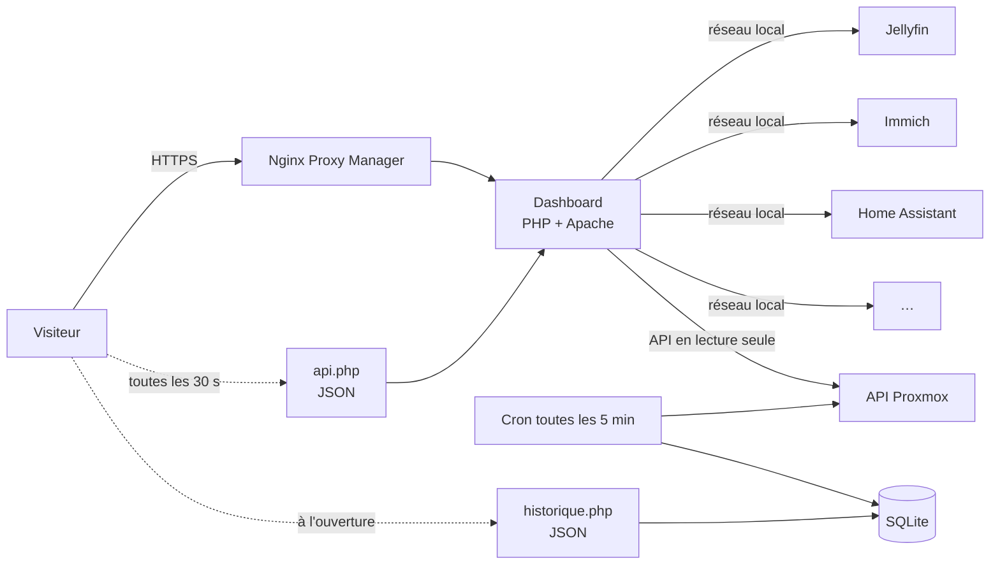

```text
 ____               _      _                              _
|  _ \   __ _  ___ | |__  | |__    ___    __ _  _ __   __| |
| | | | / _` |/ __|| '_ \ | '_ \  / _ \  / _` || '__| / _` |
| |_| || (_| |\__ \| | | || |_) || (_) || (_| || |   | (_| |
|____/  \__,_||___/|_| |_||_.__/  \___/  \__,_||_|    \__,_|
```

# 📊 Dashboard Homelab

Page web publique qui affiche l'état des services de mon [homelab](https://github.com/titouandup/homelab) : qui est en ligne, qui est hors ligne, la charge du serveur et son historique sur 24 h. La page se met à jour toute seule toutes les 30 secondes.

Hébergée sur le homelab lui-même, dans un conteneur Docker, et exposée en HTTPS via Nginx Proxy Manager.

---

## ⚙️ Fonctionnement



1. Le visiteur ouvre la page : le serveur PHP la génère complète.
2. Il interroge **en parallèle** chaque service sur le réseau local (`curl_multi`, timeout 2 s).
3. Toute réponse HTTP prouve que le service tourne : il est affiché **En ligne**, sinon **Hors ligne**.
4. Il lit aussi le CPU, la RAM et le disque du serveur via l'API Proxmox. Si l'API ne répond pas, le bloc est simplement masqué.
5. Les résultats sont **mis en cache 30 s**, échecs compris : au plus une série de tests toutes les 30 s, quel que soit le nombre de visiteurs ou d'onglets ouverts.
6. Le visiteur reçoit uniquement le résultat : jamais les adresses ni les ports internes.
7. Ensuite, un petit script JavaScript redemande l'état à `api.php` toutes les 30 s et met la page à jour **sans la recharger**. Si la requête échoue, la page garde ses dernières valeurs.
8. Toutes les 5 minutes, une tâche planifiée (cron) lance un script en ligne de commande : il enregistre le CPU, la RAM et le disque dans une base **SQLite** et supprime les mesures de plus de 7 jours. Un visiteur ne déclenche jamais d'écriture.
9. À l'ouverture de la page, le JavaScript demande les 24 dernières heures à `historique.php` et dessine le graphique avec Chart.js. Si le serveur Proxmox est resté injoignable un moment, la courbe se coupe à cet endroit au lieu de relier les points.

---

## 🔐 Sécurité

Le dashboard est exposé sur Internet, il a donc été pensé pour **ne rien révéler et ne rien permettre** :

- **Lecture seule** : aucune action possible (pas de redémarrage, pas de connexion).
- **Aucune adresse interne publiée** : les IP et ports sont dans `src/config.php`, ignoré par Git. Le dépôt ne contient qu'un modèle (`config.exemple.php`).
- **Token Proxmox en lecture seule** (rôle `PVEAuditor`), stocké dans un `.env` ignoré par Git. Il est placé à la racine du dépôt, hors de `src/` : il n'est donc jamais servi par le site.
- **Cache de 30 s** (services et Proxmox, échecs compris) : recharger la page ou appeler l'API en boucle ne provoque pas d'appels en rafale vers le réseau interne.
- **Pas de SSRF** : les URL testées sont fixées côté serveur ; le visiteur ne peut pas choisir ce que le serveur interroge.
- **API JSON minimale** : `api.php` ne prend aucun paramètre et renvoie champ par champ (liste blanche) uniquement des booléens, des pourcentages et l'heure. Aucun nom, aucune adresse.
- **Erreurs PHP jamais affichées** : un `php.ini` désactive `display_errors`, elles vont dans les logs du conteneur. Une erreur ne révèle donc jamais le chemin des fichiers du serveur.
- **Échappement des sorties** : `htmlspecialchars()` côté PHP, `textContent` (jamais `innerHTML`) côté JavaScript.
- **Code monté en lecture seule** dans le conteneur (`:ro`).
- **Historique écrit uniquement par le cron** : un visiteur ne peut rien enregistrer. `historique.php` est en lecture seule, sans paramètre, et répond par une erreur 500 sans aucun détail si la base est illisible.
- **Un seul dossier inscriptible** : `data/`, qui contient la base SQLite (ignorée par Git). Le script du cron est monté en lecture seule, hors de la racine web (`bin/`).
- **Chart.js hébergé en local** (version figée) : la page ne contacte aucun site tiers.
- Seul le dashboard est exposé : les services surveillés restent inaccessibles depuis l'extérieur.

---

## 🧰 Technologies

| Rôle | Outil |
|---|---|
| Back-end | PHP 8.3 (cURL, PDO) |
| Supervision | API REST Proxmox (token en lecture seule) |
| Historique | SQLite, alimentée par une tâche cron |
| Front-end | HTML, CSS, JavaScript (`fetch`) |
| Graphiques | Chart.js 4.4.9, hébergé en local |
| Serveur | Apache (image `php:8.3-apache`) |
| Déploiement | Docker Compose |
| Exposition | Nginx Proxy Manager + Let's Encrypt |

---

## 🚀 Installation

```bash
git clone https://github.com/titouandup/dashboard-homelab.git
cd dashboard-homelab
cp src/config.exemple.php src/config.php
nano src/config.php      # renseigner les adresses locales des services
nano .env                # PROXMOX_URL, PROXMOX_NODE, PROXMOX_TOKEN_ID, PROXMOX_TOKEN_SECRET
mkdir data && sudo chown 33:33 data   # dossier de la base SQLite, inscriptible par Apache (www-data)
docker compose up -d
```

Le dashboard est alors disponible sur `http://<ip-du-serveur>:8090`.

Pour alimenter l'historique, ajouter une tâche cron sur la machine qui héberge Docker (`crontab -e`) :

```cron
*/5 * * * * docker exec -u www-data dashboard php /app/bin/enregistrer.php >> $HOME/dashboard-historique.log 2>&1
```

Sans cette tâche, le graphique reste masqué. Les erreurs éventuelles du script sont écrites dans le fichier de log.

Ajouter un service = ajouter une ligne dans `src/config.php`, sans toucher au code.

Le token Proxmox se crée dans l'interface (Datacenter → Permissions) : un utilisateur dédié avec le rôle `PVEAuditor`, puis un token sans séparation de privilèges. Sans `.env` valide, le bloc « Serveur » n'est pas affiché, mais les statuts des services continuent de fonctionner.

---

## 📁 Structure

```
dashboard-homelab/
├── docker-compose.yml
├── php.ini                  erreurs PHP dans les logs, jamais dans la page
├── .env                     secrets Proxmox (ignoré par Git, hors de src/)
├── bin/
│   └── enregistrer.php      script du cron : enregistre une mesure (hors de la racine web)
├── data/                    base SQLite de l'historique (ignorée par Git, inscriptible)
└── src/
    ├── index.php            affiche la page
    ├── api.php              renvoie l'état en JSON pour le rafraîchissement
    ├── historique.php       renvoie les mesures des dernières 24 h en JSON
    ├── fonctions.php        tests des services, API Proxmox, cache, base SQLite
    ├── dashboard.js         met la page à jour toutes les 30 s et dessine le graphique
    ├── chart.umd.min.js     Chart.js 4.4.9 (hébergé en local)
    ├── style.css            style, thème jour / nuit, affichage téléphone
    └── config.exemple.php   modèle de configuration
```

---

## 🗺️ Feuille de route

- [x] **v1** : statut en ligne / hors ligne de chaque service
- [x] **v2** : nouveau style, CPU, RAM et disque du serveur via l'API Proxmox (token en lecture seule, mise en cache)
- [x] **v3** : rafraîchissement automatique en JavaScript (`fetch` + JSON), cache des services, `php.ini` de production
- [ ] **v4** : historique en base SQLite et graphiques (Chart.js)
- [ ] **v5** : température intérieure depuis un capteur ESP32 via Home Assistant

---

## 🌐 Accès

Le dashboard est en ligne, hébergé sur mon propre serveur :

**👉 https://dashboard.dupouyfam.duckdns.org/**

- Aucun compte ni connexion : la page est publique et en lecture seule.
- La page se met à jour toute seule toutes les 30 s : l'heure « Mis à jour à » indique le dernier rafraîchissement.
- Il tourne sur un petit serveur à la maison : une coupure ou une maintenance peut le rendre indisponible de temps en temps.
