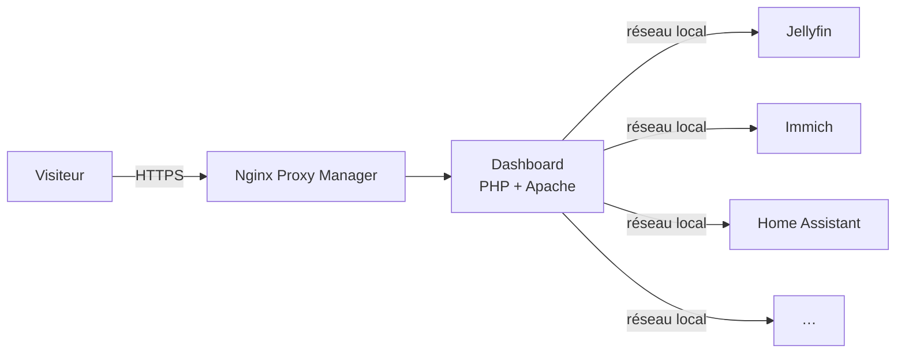

# 📊 Dashboard Homelab

Page web publique qui affiche en temps réel l'état des services de mon [homelab](https://github.com/titouandup/homelab) : qui est en ligne, qui est hors ligne.

Hébergée sur le homelab lui-même, dans un conteneur Docker, et exposée en HTTPS via Nginx Proxy Manager.

---

## ⚙️ Fonctionnement



1. Le visiteur ouvre la page.
2. Le serveur PHP interroge **en parallèle** chaque service sur le réseau local (`curl_multi`, timeout 2 s).
3. Toute réponse HTTP prouve que le service tourne : il est affiché **En ligne**, sinon **Hors ligne**.
4. Le visiteur reçoit uniquement le résultat : jamais les adresses ni les ports internes.

---

## 🔐 Sécurité

Le dashboard est exposé sur Internet, il a donc été pensé pour **ne rien révéler et ne rien permettre** :

- **Lecture seule** : aucune action possible (pas de redémarrage, pas de connexion).
- **Aucune adresse interne publiée** : les IP et ports sont dans `src/config.php`, ignoré par Git. Le dépôt ne contient qu'un modèle (`config.example.php`).
- **Pas de SSRF** : les URL testées sont fixées côté serveur ; le visiteur ne peut pas choisir ce que le serveur interroge.
- **Échappement des sorties** avec `htmlspecialchars()`.
- **Code monté en lecture seule** dans le conteneur (`:ro`).
- Seul le dashboard est exposé : les services surveillés restent inaccessibles depuis l'extérieur.

---

## 🧰 Technologies

| Rôle | Outil |
|---|---|
| Back-end | PHP 8.3 (cURL) |
| Front-end | HTML, CSS |
| Serveur | Apache (image `php:8.3-apache`) |
| Déploiement | Docker Compose |
| Exposition | Nginx Proxy Manager + Let's Encrypt |

---

## 🚀 Installation

```bash
git clone https://github.com/titouandup/dashboard.git
cd dashboard
cp src/config.example.php src/config.php
nano src/config.php      # renseigner les adresses locales des services
docker compose up -d
```

Le dashboard est alors disponible sur `http://<ip-du-serveur>:8090`.

Ajouter un service = ajouter une ligne dans `src/config.php`, sans toucher au code.

---

## 📁 Structure

```
dashboard/
├── docker-compose.yml
└── src/
    ├── index.php            vérifie les services et affiche la page
    ├── style.css
    └── config.example.php   modèle de configuration
```

---

## 🗺️ Feuille de route

- [x] **v1** : statut en ligne / hors ligne de chaque service
- [ ] **v2** : CPU, RAM et disque du serveur via l'API Proxmox (token en lecture seule, mise en cache)
- [ ] **v3** : rafraîchissement automatique en JavaScript (`fetch` + JSON)
- [ ] **v4** : historique en base SQLite et graphiques (Chart.js)
- [ ] **v5** : température intérieure depuis un capteur ESP32 via Home Assistant
